# METEOMATRIX | Enterprise Weather Intelligence Dashboard

A high-performance, real-time weather analytics and commute intelligence dashboard engineered using **Asynchronous JavaScript (`async`/`await`)** and **RESTful Web APIs**. Built with an executive, modern office/workplace aesthetic tailored for corporate desks, command centers, and business travelers.

---

## 🌟 Key Features

### 1. Modern Asynchronous JavaScript Architecture
- **Native Fetch API & `async`/`await`**: Structured asynchronous pipeline requesting meteorological and geocoding telemetry without external framework bloat.
- **Concurrent API Requests**: Uses `Promise.all` to fetch meteorological forecasts and real-time air quality metrics in parallel, cutting load latency by over 50%.
- **Request Lifecycle & Abort Management**: Integrates native `AbortController` to handle network timeouts (9-second threshold) and prevents stale asynchronous state race conditions.

### 2. Comprehensive Network Resilience & Error Handling
- **Granular Status Code Verification**: Validates HTTP response states (`response.ok`) with tailored diagnostics for 404 (location unresolvable), 429 (rate limits), and 5xx (server faults).
- **Network Connection Watcher**: Real-time listener on `window.addEventListener('online' | 'offline')` displaying persistent corporate alert banners when connectivity drops.
- **Graceful Fallback & Retry Strategy**: Fallback action triggers allowing one-click retry or instant return to corporate headquarters (London Station).
- **Non-blocking Toast Notifications**: In-app feedback system for seamless status telemetry updates.

### 3. Nested JSON Parsing & Dynamic DOM Rendering
- **Complex Hierarchical Traversal**: Parses multi-layered JSON payloads including root metadata (timezone, elevation), `current` metrics, `hourly` arrays (24-hour timeline), `daily` arrays (7-day outlook), and `air_quality` indices.
- **Dynamic Metric Computations**: Derives real-time dew point temperatures, wind directions with compass rotation, barometric trends, daylight duration, and WMO weather condition icons.
- **Loading Skeletons**: CSS shimmer skeletons prevent layout shifts during asynchronous state transitions.

### 4. Advanced City Search & Live Autocomplete
- **Debounced Live Autocomplete**: Real-time geocoding queries against Open-Meteo Geocoding REST API with a 250ms debounce to prevent request spam.
- **Global Business Hubs**: Instant one-click query bar for premier financial hubs: London, New York, Tokyo, Singapore, Frankfurt, Zurich, San Francisco, and Bengaluru.
- **HTML5 Geolocation Integration**: Resolves device coordinates with reverse-geocoding for local station monitoring.
- **Session History Persistence**: Saves recent location queries to `localStorage` with individual removal controls.

### 5. Office & Workplace Intelligence Engine
- **Commute Condition Advisory**: Real-time travel safety ratings (wet roads, wind gusts, transit warnings).
- **Corporate Attire Guidance**: Smart apparel suggestions based on ambient temperatures and precipitation risks.
- **Indoor HVAC Recommendations**: Energy-efficient indoor climate settings calculated from outdoor temperature and relative humidity.
- **Outdoor Business Lunch Viability**: Instant score for patio dining and outdoor business gatherings.
- **Station Synchronized Clock**: Live seconds-accurate clock synchronized with the target city's timezone.

### 6. Corporate Office Visual Design System
- **Executive Dark (Default)**: Deep obsidian, slate navy, and cyan accents for reduced eye fatigue during long office hours.
- **Corporate Light (Toggleable)**: Crisp paper and cool steel palette for brightly lit boardrooms.
- **Unit Precision**: Instant unit toggle between Metric (°C, km/h) and Imperial (°F, mph) with dynamic recalculation without re-fetching.

---

## 🏛️ System Architecture & Data Flow

```mermaid
flowchart TD
    User([User Input / Hub Click]) --> SearchEngine{Search Form / Autocomplete}
    SearchEngine -->|City Query| GeocodingAPI[Open-Meteo Geocoding REST API]
    GeocodingAPI -->|Coordinates & Timezone| StateManager[App State Manager]
    
    DeviceGeo([Device Geolocation]) -->|Lat / Lon| RevGeo[Reverse Geocoding Service]
    RevGeo --> StateManager
    
    StateManager --> FetchPipeline[Async Promise.all Pipeline]
    
    subgraph RESTful API Services
        FetchPipeline --> ForecastAPI[Open-Meteo Forecast REST API]
        FetchPipeline --> AirQualityAPI[Open-Meteo Air Quality REST API]
    end
    
    ForecastAPI -->|Current, Hourly, Daily JSON| Parser[Nested JSON Parser & Engine]
    AirQualityAPI -->|US AQI & PM2.5 JSON| Parser
    
    Parser --> UI[UI Controller]
    UI --> Hero[Hero Observation Card]
    UI --> Advisory[Workplace & Commute Advisory]
    UI --> KPIs[Corporate KPI Metrics Grid]
    UI --> Ephemeris[Solar Daylight Progression]
    UI --> Hourly[24-Hour Timeline Dispatch]
    UI --> MultiDay[7-Day Strategic Forecast]
    UI --> Clock[Live Timezone Station Clock]
```



---

## 📂 Project Structure

```
c:\Users\Suraj\Desktop\Thiranex\Task-4\
├── index.html        # Semantic HTML5 dashboard layout with accessible ARIA landmarks
├── styles.css        # Executive office design system (Dark/Light themes, responsive grid)
├── app.js            # Asynchronous JavaScript engine (Fetch API, error handling, state)
└── README.md         # Comprehensive technical documentation
```

---

## 🚀 Getting Started

No build tools, bundlers, or API keys are required. The dashboard runs directly in any modern web browser.

### Option A: Direct Browser Launch
Simply double-click `index.html` or open it with your browser:
```powershell
Start-Process "index.html"
```

### Option B: Local Development Server (Recommended)
You can serve the directory using Node.js:
```powershell
npx serve -l 3000
```
Then navigate to `http://localhost:3000`.

---

## 🌐 Public REST APIs Used

| Endpoint | Provider | Authentication | Purpose |
| :--- | :--- | :--- | :--- |
| `/v1/search` | **Open-Meteo Geocoding** | None (Free / Open) | Resolves city names to lat/lon coordinates & timezones |
| `/v1/forecast` | **Open-Meteo Forecast** | None (Free / Open) | Real-time current weather, 24-hr hourly, and 7-day daily data |
| `/v1/air-quality` | **Open-Meteo Air Quality** | None (Free / Open) | US AQI, PM2.5, and PM10 atmospheric purity indices |
| `/data/reverse-geocode-client` | **BigDataCloud** | None (Free / Open) | Reverse geocoding for device location lookup |

---

## 💻 Tech Stack
- **JavaScript**: ES6+, `async`/`await`, Fetch API, `AbortController`, `Intl.DateTimeFormat`
- **Styling**: Modern CSS3 (Custom Properties, Grid, Flexbox, Glassmorphism, Micro-animations)
- **Typography**: Plus Jakarta Sans, JetBrains Mono
- **Compatibility**: Chrome, Edge, Firefox, Safari (Mobile & Desktop)
