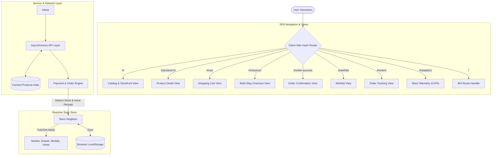

# NEXUS GEAR | Enterprise E-Commerce Platform & Full-Stack Architecture

> **Web Development Capstone Project (Task 5)**  
> A high-performance, responsive Single Page Application (SPA) e-commerce product catalog engineered with pure client-side JavaScript, custom client-side hash routing, reactive state management, and asset optimization. Designed with a clean, consolidated architecture for direct browser compatibility and effortless GitHub / cloud deployments.

---

## 🌐 Live Production Deployment

- **Live URL**: [https://effulgent-brigadeiros-18c67b.netlify.app](http://effulgent-brigadeiros-18c67b.netlify.app)  
  *(Default access passcode: `My-Drop-Site`)*
- **Primary Currency**: Indian Rupees (`INR` / `₹`) with dynamic converter (`USD`, `EUR`, `GBP`)
- **Supported Cloud Platforms**: Netlify (`netlify.toml`), Vercel (`vercel.json`), GitHub Pages, and Render.

---

## 🌟 Key Capstone Requirements & Architectural Delivery

| Capstone Requirement | Architectural Implementation |
|---|---|
| **Modular Frontend Architecture** | Consolidated into clear, decoupled layers inside `app.js`: Dataset & Config, Toast Manager, Async API Service, Reactive State Store (`Store`), UI Components (`Navbar`, `Footer`, `ProductCard`, `CartDrawer`, `QuickViewModal`), Views (`Catalog`, `ProductDetail`, `Cart`, `Checkout`, `OrderSuccess`, `Wishlist`, `Orders`, `Analytics`, `NotFound`), and SPA Router. |
| **Client-Side Routing** | Custom Hash-based SPA Router supporting parameterized routes (`#/product/:id`), search query string reflection (`?category=...&sort=...`), route transition lifecycle hooks (`beforeEach`, `afterEach`), and 404 fallback without page reloads. |
| **Asset & Code Optimization** | Standalone consolidated `style.css` (tokens, animations, layout, responsive queries) and `app.js`. Zero build dependencies, lazy-loaded CDN WebP images (`loading="lazy"`), data URI vector favicon, and Google Fonts preconnect. |
| **GitHub & Cloud Deployment Ready** | Completely merged structure (under 5 files total) allowing direct drag-and-drop or single-command git push to GitHub without hitting file limits or needing `node_modules`. |

---

## 📁 Consolidated Project Architecture

```
Task-5/
├── index.html                   # HTML5 Entry Point, SEO/OG meta, font preconnects, mount roots
├── style.css                    # Unified design tokens, responsive breakpoints, animations & views
├── app.js                       # Consolidated modular SPA core (Router, Store, API, Views, Components)
├── README.md                    # Comprehensive technical documentation & deployment guide
├── netlify.toml                 # Turnkey Netlify SPA redirect rules
└── vercel.json                  # Turnkey Vercel SPA rewrite rules
```

---

## 🏛️ System Architecture & Data Flow



---

## 🧠 Core Engineering Concepts Demonstrated

### 1. Client-Side Hash SPA Routing
Enables smooth client-side navigation with zero server roundtrips:
```javascript
const routes = [
  { path: '/', component: new CatalogView() },
  { path: '/product/:id', component: new ProductDetailView() },
  { path: '/cart', component: new CartView() },
  { path: '/checkout', component: new CheckoutView() },
  { path: '/order-success', component: new OrderSuccessView() },
  { path: '/wishlist', component: new WishlistView() },
  { path: '/orders', component: new OrdersView() },
  { path: '/analytics', component: new AnalyticsView() },
  { path: '*', component: new NotFoundView() }
];
```

### 2. Centralized Reactive State Management (`Store`)
- **Single Source of Truth**: Uses Pub/Sub listener subscriptions to broadcast changes across all UI components.
- **LocalStorage Synchronization**: Cart, Wishlist, Theme, and Currency are persisted safely across reloads.
- **Currency Engine**: Defaults to Indian Rupees (`₹`), formatting via `toLocaleString('en-IN')` with real-time recalculation on conversion.
- **Dynamic Cart Math**: Calculates promotional discounts (`NEXUS20`, `SAVE10`, `VIP50`, `FREESHIP`), free shipping thresholds (orders over ₹8,000), and 8% estimated taxes.

### 3. Asynchronous Service Layer (`ApiService`)
- Non-blocking data queries using `async`/`await` and `Promise` delays.
- Dynamic filtering (Categories, Live Search, Price Slider, Rating, In-Stock Only).
- Client mutations: customer reviews re-average ratings in real time, and placed orders deduct warehouse inventory.

---

## 🚀 How to Run & Upload to GitHub

### 1. Run Locally (Zero Setup Required)
Simply double-click `index.html` or open it with any web server (e.g. VS Code Live Server, Python `python -m http.server`, or Node `npx serve`). No `npm install` or compilation needed!

### 2. Upload to GitHub
Because all files are cleanly consolidated without heavy `node_modules`:
1. Go to your GitHub repository.
2. Click **Add file** -> **Upload files**.
3. Drag and drop the `Task-5` files (`index.html`, `style.css`, `app.js`, `README.md`, `netlify.toml`, `vercel.json`) directly into GitHub.
4. Click **Commit changes** — uploads in seconds without hitting file count limits!
